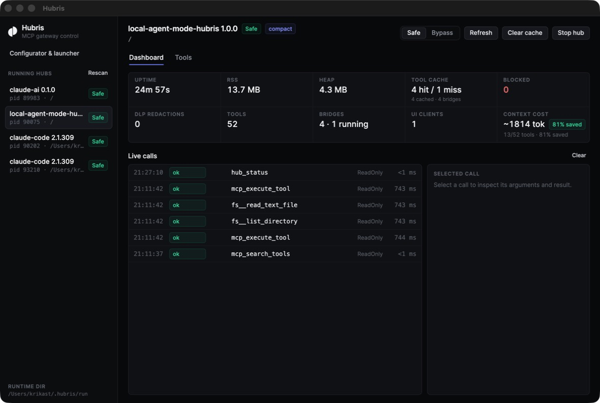

# Hubris

MCP gateway. One stdio server that sits between an MCP client (Claude Desktop, Claude Code, Cursor, VS Code)
and all the MCP servers you actually use. It caches their tool definitions so they don't have to be spawned
at startup, keeps most of their tools out of the model's context until they are needed, blocks destructive
calls in Safe mode and asks you in a desktop app before letting them through.

.NET 10, Native AOT, no reflection, no runtime to install. A desktop app (Avalonia) does configuration,
takeover of existing client configs, live call view and approvals.



## Numbers

Measured on an M-series Mac with the 4 bridges from my own `~/.hubris/config.json`
(filesystem, playwright, figma, one node server), 52 tools in total.

| | without Hubris | with Hubris |
|---|---|---|
| `tools/list` sent to the model | 52 tools, 38 444 bytes (~9 600 tokens) | 3 tools, 1 558 bytes (~390 tokens) in `--compact` mode |
| context used after unlocking the tools a task needs | all 52 | 13 of 52, ~1 800 tokens (81 % less, from `hub_status` on a real session) |
| time until `tools/list` is answered | ~1.8 s (every bridge spawned via `npx`) | 72 ms (definitions served from the SQLite cache, bridges spawned on first call) |
| MCP server processes after start | 4 (one per server) | 0 (bridges start lazily; 1 of 4 running after a typical session) |
| server binary | | 5.1 MB, starts in ~50 ms, ~13 MB RSS in steady state |

The token numbers are bytes/4 estimates. The second row comes from a live session where the model
searched for and unlocked 10 bridged tools; the rest stayed off the list.

## How it works

```
client ──stdio──▶ Hubris ──stdio──▶ bridge 1 (npx …)
                    │    ──stdio──▶ bridge 2
                    │    ──stdio──▶ …
                    └──unix socket──▶ Hubris.Desktop (approvals, dashboard, config)
```

- **Compact context.** With `--compact` the model sees three tools: `hub_status`, `mcp_search_tools`
  and `mcp_execute_tool`. It searches by keyword, the matches get unlocked (`notifications/tools/list_changed`),
  and it calls them directly or through `mcp_execute_tool {toolName, arguments}`. `Lock` in the desktop app
  puts them away again.
- **Tool cache.** Bridge tool definitions are stored in `~/.hubris/cache.db` keyed by command, args and env
  key names, with a TTL (`--cache-ttl`, default 24 h). On the next start the definitions are served from the
  cache and the child process is only started on the first real call to one of its tools.
- **Safe mode.** Tools are classified read-only / mutating / destructive from their annotations and names.
  Read-only calls pass, mutating calls have their arguments scanned for things like `rm -rf`, `DROP TABLE`,
  `git push --force`, destructive calls are blocked. A blocked call waits for Approve / Deny in the desktop app
  (`--approval-timeout`, default 120 s) and fails with `[SAFE MODE BLOCKED]` if nobody answers. "Remember for
  this session" covers a tool's declared risk, never an argument-pattern hit. `--mode=bypass` turns all of it off.
- **DLP.** Tool output is scanned for API keys, bearer tokens, card numbers, IBANs and Czech birth numbers
  and the values are masked before they reach the model.
- **Takeover.** The desktop app scans the MCP configs of Claude Desktop, Claude Code (including per-project
  entries in `~/.claude.json`), Cursor, Windsurf, VS Code and project-level `.mcp.json` / `.cursor/mcp.json` /
  `.vscode/mcp.json`, imports the servers into `~/.hubris/config.json` and rewrites the client config so that it
  points at Hubris only. A snapshot goes to `~/.hubris/backups/` and Restore puts things back exactly as they were.

## Install

Requirements: .NET SDK 10. On macOS the Xcode command line tools (for the linker).

```bash
dotnet publish src/Hubris -c Release
# -> src/Hubris/bin/Release/net10.0/<rid>/publish/Hubris
```

Register it with a client:

```bash
Hubris --install-claude --compact        # Claude Desktop (writes claude_desktop_config.json, keeps a .bak)
Hubris --install-vscode --compact        # .vscode/mcp.json in the current directory
claude mcp add hubris -- /path/to/Hubris --stdio --compact
```

Or let the desktop app do it: open the configurator, Scan, Import & hijack. Quit the client first, the app
refuses to rewrite the config of a running client.

Bridges live in `~/.hubris/config.json` (mode 0600):

```json
{
  "bridges": [
    { "name": "fs", "command": "npx", "args": ["-y", "@modelcontextprotocol/server-filesystem", "/Users/me/dev"] },
    { "name": "gh", "command": "npx", "args": ["-y", "@modelcontextprotocol/server-github"],
      "env": { "GITHUB_TOKEN": "…" } }
  ]
}
```

They can also be given on the command line with `--bridge=name:command arg…`. Bridged tools show up as
`fs__read_file`, `gh__create_issue` and so on.

## Usage

```
Hubris --stdio [--compact] [--mode=safe|bypass] [--approval-timeout=120] [--cache-ttl=24h]
       [--no-cache] [--no-control] [--verbose] [--bridge=<name>:<command> [args…]]…
```

Built-in tools: `hub_status`, `git_smart_status`, `fs_read_head`, `mcp_search_tools`, `mcp_execute_tool`.

The control socket is `~/.hubris/run/<pid>.sock`; the desktop app finds running hubs through it, and the
following commands are available over it: `get_status`, `list_tools`, `set_mode`, `approve`, `deny`, `forget`,
`list_decisions`, `reveal`, `lock`, `clear_cache`, `reload_config`, `cache_maintain`, `shutdown`.
`HUBRIS_HOME` moves the whole state directory.

## Desktop app

```bash
dotnet publish src/Hubris.Desktop -c Release
build/bundle-macos.sh                 # macOS: publishes both and writes artifacts/Hubris.app
build/bundle-macos.sh --no-publish    # bundle the existing publish output
```

Sidebar lists running hubs (a hub built from an older version is marked). Per hub: Safe / Bypass switch,
pending approvals with a remember checkbox, telemetry (calls, blocked, DLP redactions, cache hits, bridges
running, context cost), live call log with request/response inspector, the tool list with Lock / Unlock /
Forget. The configurator tab does client config scan / hijack / restore, edits `config.json`, and can launch a
test instance.

The bundle is ad-hoc signed without the hardened runtime on purpose: library validation would reject the
Skia/HarfBuzz dylibs. Set `CODESIGN_IDENTITY` for a real signature.

## Tests

```bash
tests/run.sh                        # unit tests, warning-free AOT publish, e2e over stdio + control socket
dotnet test tests/Hubris.Tests      # unit tests only
```

73 xUnit tests and 58 end-to-end checks (`tests/e2e/control_test.py` drives a published binary with a
Python echo server as bridge). Both projects publish with `TreatWarningsAsErrors` and zero IL/AOT warnings.

## Layout

```
src/Hubris.Core      protocol, transport, security, DLP, tool cache, engine, control channel, client config scan
src/Hubris           the server
src/Hubris.Desktop   Avalonia 12 app
tests/Hubris.Tests   xUnit
tests/e2e            python e2e
build/               macOS bundle script, icon renderer
brand/               icon, mark, wordmark
```

## Status

Works on macOS. Paths for the client configs on Windows and Linux are in the code but not tested there.
Version 1.1.0. MIT license.
